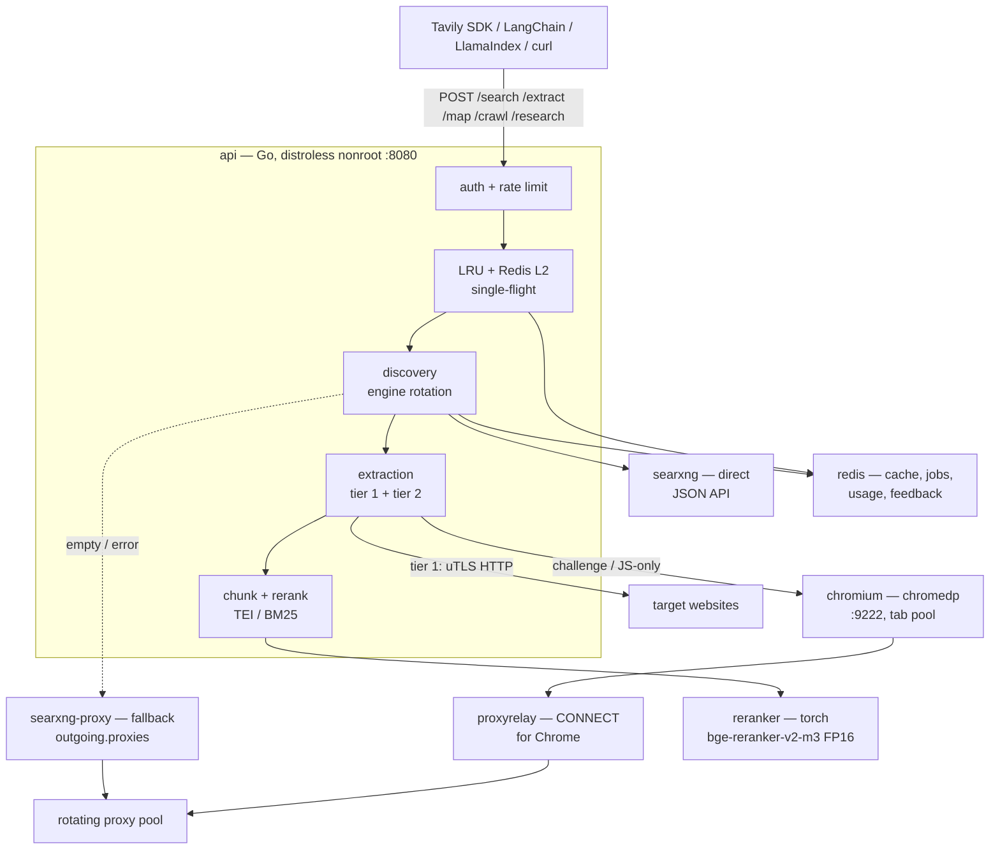
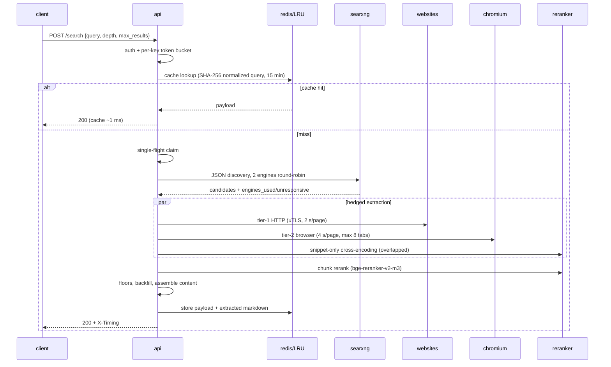

# Architecture

`tavilyd` is a single Go binary plus four sidecars. The binary owns the HTTP API,
discovery, extraction, ranking and caching; SearXNG, Redis, headless Chromium and
the GPU reranker are independent services on a private Compose network. Only
the API publishes a port.

## Topology

### Services

| service | image / build | role | published |
|---|---|---|---|
| `api` | `Dockerfile` → distroless | HTTP API, pipeline, metrics | `8080` (configurable) |
| `searxng` | `searxng/searxng:2026.11.21-c6ee3e9fd` | discovery, direct engines | no |
| `searxng-proxy` | same image + `PROXY_SEARXNG=on` | discovery through the proxy pool | no |
| `redis` | `redis:7.2.17-alpine` | cache, research jobs, usage, feedback | no |
| `browser` | `chromedp/headless-shell:159.0.8154.13` | tier-2 JS/challenge rendering | no |
| `proxyrelay` | `Dockerfile.relay` | authenticated CONNECT relay for Chrome | no |
| `reranker` | `reranker-gpu/Dockerfile` (torch 2.1.2+cu121) | `bge-reranker-v2-m3`, TEI-compatible `/rerank` | no |

## Architecture deep dives

| document | focus |
|---|---|
| [MCP architecture](docs/mcp-architecture.md) | stdio/HTTP adapter, JSON-RPC lifecycle, tools, security |
| [Search architecture](docs/search-architecture.md) | discovery, extraction tiers, reranking, floors, budgets |
| [GPU architecture](docs/tavilyd-gpu-architecture.md) | reranker sidecar, CDI, FP16, VRAM, BM25 fallback |
| [CPU architecture](docs/tavilyd-cpu-architecture.md) | CPU TEI override, batch limits, when to use it |

## `/search` request lifecycle

1. **Auth and validation** — bearer key or legacy body `api_key`, constant-time
   compare; JSON body limit; unknown fields ignored.
2. **Cache** — SHA-256 of normalized query/depth/limits/domains/raw flag; Redis
   errors degrade to no-cache. Single-flight collapses identical cold requests.
3. **Discovery** — SearXNG JSON. Basic/advanced query the direct and proxied
   instances in parallel and merge by URL, so one blocked instance cannot reduce
   a query to a single engine. Two engines per query are picked round-robin
   from `SEARCH_ENGINES`; suspended engines get a 2-minute client-side cooldown.
   `fast`/`ultra-fast` try the direct instance first; `basic`/`advanced` use the
   proxied instance and fall back to direct.
4. **Extraction (hedged)** — one goroutine per candidate bounded by a semaphore
   and `errgroup`. Tier 1 is uTLS HTTP with browser-like headers, a 5 MB cap,
   charset detection, readability and Markdown cleanup. Tier 2 (advanced only)
   escalates short, challenged or non-HTML pages to Chromium with images, fonts,
   media and trackers blocked. Failed pages fall back to the discovery snippet
   when `SNIPPET_FALLBACK=true`.
5. **Chunking and reranking** — ~350-token chunks with 50 overlap, heading and
   paragraph boundaries. A lexical pre-filter selects the best 1 (basic) or 3
   (advanced) chunks per page; TEI scores them; BM25 is the fallback. Snippets
   are cross-encoded in one batch, overlapped with page fetching.
6. **Floors and backfill** — `MIN_RESULT_SCORE`, `MIN_RELATIVE_SCORE` and a
   separate snippet floor are applied. If too few results pass, unused
   candidates are fetched lazily; the pool is up to `2 × max_results`. Results
   are never padded by lowering the floor.

### Streaming and cancellation

Extraction streams documents over a channel. Once `max_results` usable pages
exist (or the stage deadline hits), stragglers are cancelled through the
request-scoped context. A hard 6 s request deadline returns partial results
where possible.

## Other endpoints

| endpoint | implementation |
|---|---|
| `POST /extract` | same fetcher, per-request timeout ceiling, optional query reranking |
| `POST /exa/search` | Exa request/response shape mapped onto the local search pipeline |
| `POST /exa/contents` | Exa content request mapped onto the local extractor |
| `POST /map` | discovery + URL extraction, no page bodies |
| `POST /crawl` | bounded BFS from a root URL, depth/page caps |
| `POST /research` | queued job, Qwen plan/search/read/reflect/write, Redis store, SSE |
| `GET /research/{id}` | 202 while pending, 200 when done/failed |
| `GET /health` `/livez` `/readyz` | core/optional dependency model |
| `GET /metrics` | internal Prometheus listener only |

## Exa facade

`/exa/search` and `/exa/contents` are compatibility adapters, not a second
search engine. They accept Exa's names (`query`, `numResults`, `type`,
`contents`, `ids`, `x-api-key`) and return Exa's envelope
(`results[]`, `highlights`, `text`, `publishedDate`, `requestId`, `statuses`,
`costDollars`). Mapping:

| Exa | local behavior |
|---|---|
| `type: lite` | `fast` depth |
| `type: auto` | `basic` depth |
| `type: deep` / `deep-lite` | `advanced` depth |
| `numResults` | default 10, clamped to local max 20 |
| `contents.text` | sets `include_raw_content`, returns `text` |
| `contents.highlights` | returns the ranked content as one highlight |
| `contents.summary` | accepted, not synthesized |
| `includeDomains` / `excludeDomains` / dates | passed through |
| `costDollars.total` | always `0` (our index, not Exa's paid API) |

The facade gets `RequestDeadline + 2s` (8s) because per-result image extraction
is kept on; Tavily endpoints retain the 6 s hard budget. Failures in
`/exa/contents` are listed under `statuses[]` rather than failing the response.

## Concurrency and budgets

| control | default |
|---|---|
| request deadline | 6 s |
| tier-1 page timeout | 2 s (basic), 4 s (advanced) |
| browser tabs | 8 |
| fetch concurrency | 12 (production 16) |
| chunk caps | 24/page, 200/request |
| candidate pool | 2 × max_results, initial max_results + 2 |
| proxy retry budget | 1 per page |

Every outbound call takes a context. Goroutine lifetimes are bounded by the
request context or an explicit stage context; `goleak` covers key packages.

## Caching

| layer | key | TTL |
|---|---|---|
| in-process LRU | normalized search request | 15 min |
| Redis search payload | same | 15 min |
| extracted markdown | URL + cache version | 24 h |
| negative extraction | URL | 5 min |
| research job | job id | 24 h |

`CACHE_VERSION` invalidates stale extraction/cleanup output after a pipeline
change. Redis failures never turn into a 5xx; the service runs cacheless.

## Security

- **SSRF**: resolve once, reject private/loopback/link-local/CGNAT/metadata
  ranges, pin the validated IP through a `net.Dialer.Control` hook, re-validate
  every redirect, cap redirects. Optional allowlist for private targets.
- **Auth**: constant-time key comparison; auth disabled only when `API_KEY` is
  unset (a startup warning is logged).
- **Rate limiting**: per-key token bucket, `429` with `Retry-After`.
- **Containers**: nonroot distroless API, read-only rootfs, `cap_drop: ALL`,
  `no-new-privileges`, internal-only sidecars.
- **Logging**: API keys and full page bodies are never logged; proxy credentials
  are redacted.

## Observability

- `log/slog` JSON logs, request id, stage timings.
- Prometheus: HTTP, per-stage duration, cache, extraction outcomes, rerank,
  dependency health, engine suspensions, proxy outcomes.
- `X-Timing: cache=…;search=…;tier1=…;tier2=…;rerank=…;total=…` on responses.
- Optional OTLP tracing (`OTEL_ENABLED`), pprof on an internal-only port.
- `/health` separates **core** (redis, searxng, reranker, browser) from
  **optional** (llm, proxy, engines). Optional failures appear under
  `optional_degraded` without flipping overall status.

## Key design decisions and trade-offs

| decision | why |
|---|---|
| Own GPU reranker instead of TEI CUDA | the P4000 is cc 6.1; TEI CUDA images need ≥7.0 |
| Snippet fallback + snippet cross-encoding | extraction failures no longer shrink result counts; BM25 stopword false positives removed |
| Engine rotation with cooldown | one blocked engine (brave) must not stall every query |
| Proxy-primary `basic`, direct-first `fast` | quality for deep search, latency for fast |
| Lexical pre-filter before TEI | cross-encoder cost is linear in tokens; 1/3 chunks per page keeps p50 within budget |
| Floor + lazy backfill | never pad with junk; return fewer results if needed |
| `include_answer` 1.5 s cap | answers are a bonus, not a blocker for search |

## Known limitations

- Cold `basic` p50 is ~2.8 s and `fast` ~2.1 s on the current deployment —
  above the original targets; discovery is the floor (see `BENCHMARKS.md`).
- Proxy TLS handshakes cost 1–5 s; per-engine timeouts still show up under load.
- Brave is IP-blocked in this deployment and is excluded from `SEARCH_ENGINES`.
- The uTLS path speaks HTTP/1.1; HTTP/2 fingerprinting is out of scope.
- Token counts for chunking are estimated (`CHARS_PER_TOKEN`), not tokenizer-exact.
- `include_images` is best-effort; image extraction depends on the page markup.
- The Exa facade is not Exa's neural index: no `summary` synthesis, no
  pagination, and `numResults` is capped at 20. It gets an 8 s deadline so
  image extraction can finish.
