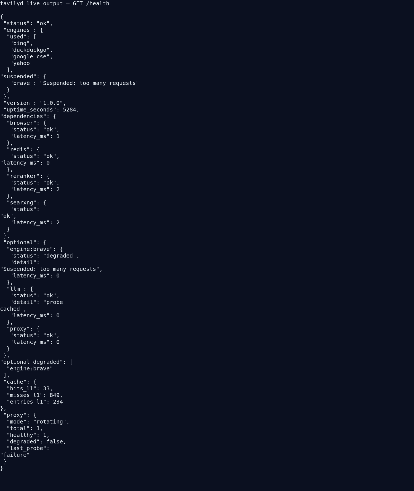
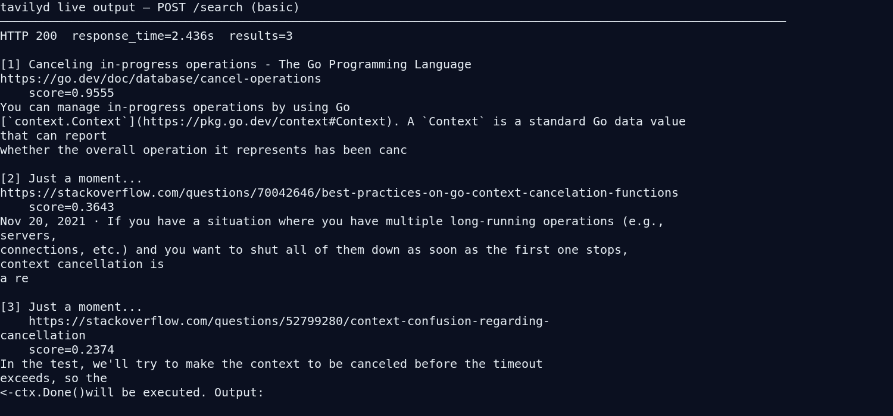
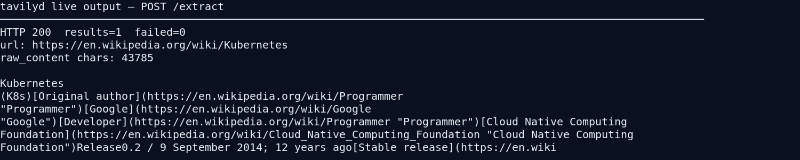
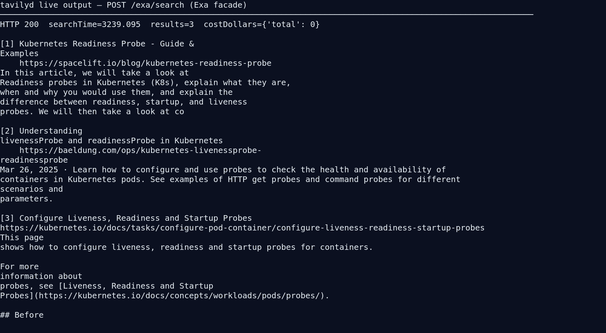
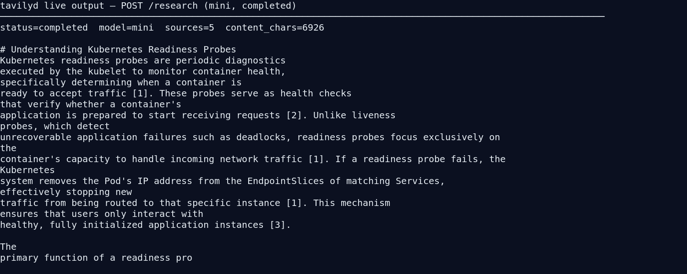
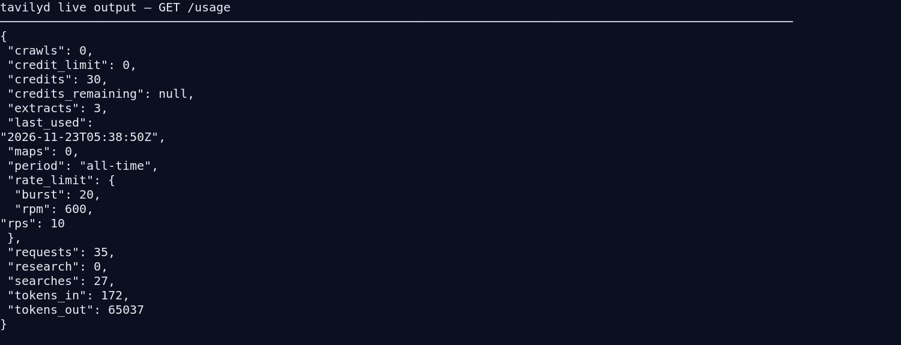
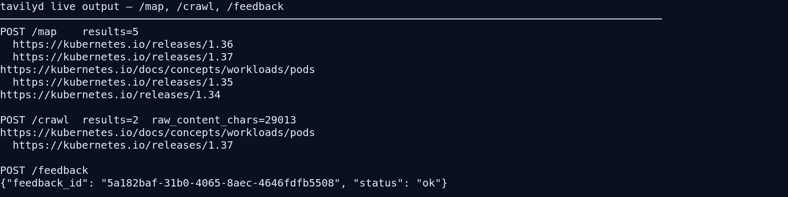
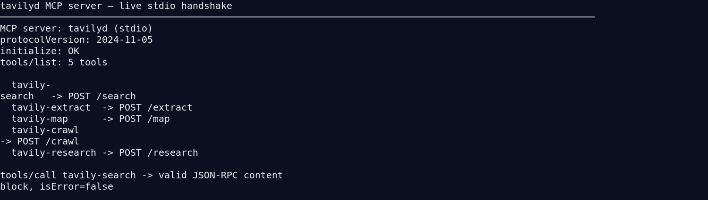
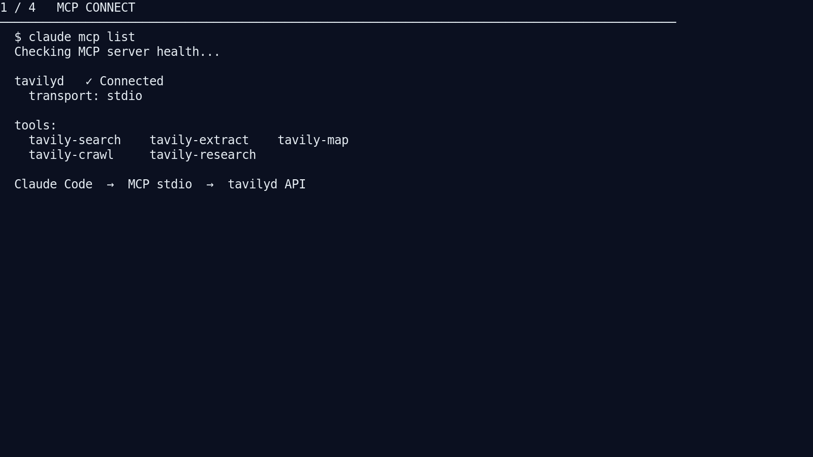

# tavilyd — self-hosted, Tavily-compatible search & extract API

[](https://github.com/codewith-aditya/tavilyd/releases/tag/v1.0.0)
[](go.mod)
[](LICENSE)
[](docker-compose.yml)
[](Makefile)

> **Independent project.** Not affiliated with or endorsed by Tavily or Exa.
> "Tavily-compatible" and the Exa facade are descriptive interoperability
> claims; this repository ships its own implementation and index.

A drop-in replacement for Tavily's `POST /search` and `POST /extract`, built for
AI agents. Tavily SDKs, LangChain and LlamaIndex clients only need their
`base_url` pointed at this service. An Exa-compatible facade
(`/exa/search`, `/exa/contents`) is included for Exa SDK clients.

- **Discovery** through a private SearXNG (Bing, DuckDuckGo, Yahoo, Google CSE;
  engines rotate two per query with a cooldown for blocked engines).
- **Two-tier extraction**: raw HTTP with a Chrome TLS fingerprint (uTLS), then a
  headless Chromium for JS-only or challenge-gated pages.
- **GPU reranking** with `BAAI/bge-reranker-v2-m3` via a TEI-compatible torch
  sidecar, with a
  BM25 fallback that keeps the service serving when the GPU is gone.
- **Tavily and Exa facades**: Tavily SDKs use `/search` + `/extract`; Exa SDKs
  can use `/exa/search` + `/exa/contents` (same local engine, `costDollars: 0`).
- **Per-key accounting** — request/search/extract/crawl/research counts, credits,
  token estimates and rate-limit metadata in `GET /usage`.
- **Two-tier caching** (in-process LRU + Redis) with single-flight.
- **SSRF-safe** fetching: DNS is resolved once, every redirect is re-validated,
  and the dialler only connects to pre-approved IPs.

```
   Tavily SDK / LangChain / LlamaIndex / curl
                    │  POST /search, /extract (h2c)
                    ▼
        ┌──────────────────────────────┐
        │ api (Go, distroless)         │
        │  auth → rate limit → cache   │
        └───┬───────────┬──────────┬───┘
            │           │          │
   discovery│   tier 1  │  tier 2  │ rerank
            ▼           ▼          ▼
      ┌──────────┐ ┌─────────┐ ┌──────────┐   ┌──────────────┐
      │ searxng  │ │ target  │ │ browser  │   │ reranker TEI │
      │ :8080    │ │ sites   │ │ :9222    │   │ GPU :80      │
      └──────────┘ └─────────┘ └──────────┘   └──────────────┘
            │                        │
            └────────┬───────────────┘
                     ▼
              ┌────────────┐
              │ redis :6379│  LRU in api + Redis L2
              └────────────┘
```

## Benchmark headline

Extended relevance evaluation: **100 queries × 3 cold runs (300 judged runs)**,
Qwen judge (0/1/2), top-5 results, prompt committed in
`scripts/judge_relevance.tmpl`.

| config | P@3 | P@5 | junk top-5 | avg results | p50 |
|---|---|---|---|---|---|
| **floor=0** | **0.988** | **0.969** | **3.1%** | 8.5 | **2019 ms** |
| floors 0.10 / 0.05 | 0.943 | 0.902 | 9.8% | 6.9 | 2692 ms |

Floor=0 wins precision, junk rate and latency once snippet fallback and
cross-encoded snippets are wired. Full methodology, per-config spread and
worst-20 lists: [BENCHMARKS.md](BENCHMARKS.md).

## Verified live outputs

Captured from a real running instance, not mocks. The images are rendered
directly from the captured JSON (API keys and internal endpoints removed).

| endpoint | live output |
|---|---|
| `GET /health` | [](docs/assets/demo-health.png) |
| `POST /search` (basic) | [](docs/assets/demo-search.png) |
| `POST /extract` | [](docs/assets/demo-extract.png) |
| `POST /exa/search` | [](docs/assets/demo-exa.png) |
| `POST /research` (mini) | [](docs/assets/demo-research.png) |
| `GET /usage` | [](docs/assets/demo-usage.png) |
| `/map`, `/crawl`, `/feedback` | [](docs/assets/demo-platform.png) |
| MCP stdio handshake | [](docs/assets/demo-mcp.png) |

The rendered captures are in `docs/assets/`; raw third-party page bodies are
not committed. Regenerate them from actual responses, never from mock data.

## Documentation

| | |
|---|---|
| [Architecture](ARCHITECTURE.md) | services, request lifecycle, concurrency, security, trade-offs |
| [Benchmarks](BENCHMARKS.md) | measured latency, 60/100-query judged evals, engine/proxy/GPU numbers |
| [Docs index](DOCS.md) | API quick reference, auth, SDK base-URL examples, Exa facade, health model |
| [Contributing](CONTRIBUTING.md) | dev setup, tests, PR checklist, adding config/engines |
| [Security](SECURITY.md) | private vulnerability reporting, scope, operator hardening |
| [MCP server](docs/mcp.md) | stdio + HTTP tools, client setup, security and troubleshooting |
| [MCP architecture](docs/mcp-architecture.md) | adapter topology, JSON-RPC lifecycle, tool map, failure modes |
| [Search architecture](docs/search-architecture.md) | discovery, extraction, reranking, floors and budgets |
| [GPU architecture](docs/tavilyd-gpu-architecture.md) | reranker sidecar, CDI, FP16, VRAM, fallback |
| [CPU architecture](docs/tavilyd-cpu-architecture.md) | CPU-only override, TEI batch limits, sizing |
| [Deployment state](docs/STATE.md) | every env var and default, current production config, known traps |

**Status:** Tavily SDK/contract tests are green; cold `basic` p50 is ~2.8 s and `fast` ~2.1 s on the current proxied
deployment (targets are 1.8 s / 1.2 s — see [BENCHMARKS.md](BENCHMARKS.md)).
Warm cache hits are <1 ms.

## Quick start

Prerequisites: Docker 27+, Docker Compose v2, an NVIDIA GPU with the NVIDIA
Container Toolkit for GPU reranking (see [GPU reranker](#gpu-reranker)).

```bash
git clone <this repo> tavilyd && cd tavilyd
cp .env.example .env
# Two secrets are mandatory:
sed -i "s|^SEARXNG_SECRET=.*|SEARXNG_SECRET=$(openssl rand -hex 32)|" .env
sed -i "s|^API_KEY=.*|API_KEY=$(openssl rand -hex 24)|" .env
docker compose up -d --build
docker compose ps           # every service should be (healthy)
```

Only the `api` service publishes a port (`PUBLISH_PORT`, default 8080). SearXNG,
Redis, Chromium and TEI stay on the Compose network.

Smoke test:

```bash
curl -sS http://localhost:8080/health | jq
curl -sS -X POST http://localhost:8080/search \
  -H 'Content-Type: application/json' \
  -H "Authorization: Bearer $(grep '^API_KEY=' .env | cut -d= -f2)" \
  -d '{"query":"golang context cancellation","max_results":3}' | jq
```

## GPU reranker

The default reranker is `reranker-gpu/`: FastAPI + PyTorch + sentence-transformers
CrossEncoder serving `BAAI/bge-reranker-v2-m3` behind a TEI-compatible
`POST /rerank`. The Go client, its batching and the BM25 fallback are unchanged —
only `TEI_URL` points at this container.

### Why a sidecar instead of TEI

This host's GPU is a Quadro P4000 (compute capability 6.1). TEI's CUDA images are
built for cc >= 7.0 and refuse to start; TEI's CPU image works but cannot batch
(candle `non-contiguous lhs`) and needs ~0.6–1.0 s per 350-token chunk, which
blows the 6 s request budget. The sidecar pins
`pytorch/pytorch:2.1.2-cuda12.1-cudnn8-runtime` — the last torch line with sm_61
kernels — and `app.py` fails loudly at startup if `torch.cuda.get_arch_list()`
lacks `sm_61`.

### Precision (measured, 48 chunks x ~350 tokens, batch 16)

| dtype | median | best | chunks/s |
|---|---|---|---|
| fp32 | 1391 ms | 1384 ms | 34.5 |
| fp16 | 1319 ms | 1312 ms | 36.4 |

fp16 wins by ~5%; Pascal has no fast FP16 path, so the margin is small (on
Ampere+ it is much larger). `RERANK_DTYPE=auto` resolves to fp16 on CUDA; `fp16`
and `fp32` force a choice.

### Design

- one uvicorn worker, one GPU worker behind a lock: a request queue instead of
  concurrent kernels thrashing VRAM;
- pairs sorted by text length before batching to cut padding;
- `torch.inference_mode()`, `max_length` 512, `RERANK_BATCH_SIZE=16`;
- `/health` returns 200 only after the model is loaded *and* one warmup
  inference has completed;
- sigmoid applied unless `raw_scores=true`, results returned as
  `[{index, score}]` sorted by score — the TEI contract.

### Docker GPU wiring

When only CDI is configured (no `nvidia` runtime in `/etc/docker/daemon.json`),
`docker run --gpus all` fails with `AMD CDI spec not found` even though
`nvidia-ctk cdi list` shows the GPU. Use an explicit CDI device request:

```bash
docker run --rm --device nvidia.com/gpu=all nvidia/cuda:12.4.1-base-ubuntu22.04 nvidia-smi
```

```yaml
# compose
devices:
  - "nvidia.com/gpu=all"
```

Generate the spec with
`sudo nvidia-ctk cdi generate --output=/etc/cdi/nvidia.yaml` (nvidia-container-toolkit
1.20.2 here). This host: Quadro P4000, cc 6.1, 8192 MiB, driver
580.178.04, CUDA 13.0 capable.

### Using TEI on Turing or newer

Replace the `reranker` service's `build:`/`devices:` block with the TEI image for
your compute capability, and raise the client batch sizes
(`TEI_MAX_BATCH=32`, `TEI_PARALLELISM=4`):

| GPU generation | Compute cap. | TEI tag |
|---|---|---|
| H100 / H200 | 9.0 | `ghcr.io/huggingface/text-embeddings-inference:hopper-1.2.0` |
| A100 | 8.0 | `...:1.2.0` |
| A10 / L4 / A40 / RTX 30xx | 8.6 | `...:86-1.2.0` |
| L40 / RTX 40xx | 8.9 | `...:89-1.2.0` |
| T4 / RTX 20xx | 7.5 | `...:turing-1.2.0` |

Keep `devices: ["nvidia.com/gpu=all"]`, or replace it with
`deploy.resources.reservations.devices` if the `nvidia` runtime is registered.

### CPU-only fallback

`docker-compose.cpu-reranker.yml` keeps the old TEI CPU path:

```bash
docker compose -f docker-compose.yml -f docker-compose.cpu-reranker.yml up -d
```

It runs bge on CPU with `--max-batch-requests 1`; expect 0.6–1.0 s per chunk and
frequent BM25 fallback. Correctness testing only.

The model cache lives in the `hf-cache` volume; the first start downloads
~2.3 GB. Upgrading from the TEI container leaves a root-owned cache — chown it
once: `docker run --rm -v tavilyd_hf-cache:/data alpine chown -R 10001:10001 /data`.

## API

### GET /health

Per-dependency status (`ok | degraded | down`), version, uptime and local cache
counters. `/livez` is a pure liveness probe; `/readyz` returns 503 when SearXNG is
unreachable (Redis, browser and reranker degrade instead of failing).

```bash
curl -sS http://localhost:8080/health | jq
```

```json
{
  "status": "ok",
  "version": "1.0.0",
  "uptime_seconds": 42,
  "dependencies": {
    "browser":  {"status": "ok", "latency_ms": 4},
    "redis":    {"status": "ok", "latency_ms": 1},
    "reranker": {"status": "ok", "latency_ms": 3},
    "searxng":  {"status": "ok", "latency_ms": 11}
  },
  "cache": {"hits_l1": 0, "misses_l1": 4, "entries_l1": 4}
}
```

### GET /usage

Returns all-time counters for the calling key:

```json
{
  "period": "all-time",
  "requests": 4,
  "searches": 2,
  "extracts": 0,
  "maps": 0,
  "crawls": 0,
  "research": 0,
  "credits": 2,
  "tokens_in": 10,
  "tokens_out": 320,
  "last_used": "2026-11-23T04:06:10Z",
  "rate_limit": {"rps": 10, "burst": 20, "rpm": 600},
  "credit_limit": 1000,
  "credits_remaining": 998
}
```

With `CREDIT_LIMIT` set, requests that would cross the cap return **402 Payment
Required** with `X-Credits-Limit/Used/Remaining` headers; 429 remains the
per-second rate-limit response.

### POST /exa/search and POST /exa/contents

Exa-compatible facade. Auth accepts `x-api-key` or `Authorization: Bearer`;
requests use Exa field names (`query`, `numResults`, `type`, `contents`,
`ids`). `type` maps `lite` → fast, `deep`/`deep-lite` → advanced, otherwise
basic; `numResults` is clamped to 20; `costDollars.total` is always 0 because
this is our index. See [DOCS.md](DOCS.md#exa-compatible-facade).

```bash
curl -sS -X POST http://localhost:8080/exa/search \
  -H 'Content-Type: application/json' -H "x-api-key: $EXA_KEY" \
  -d '{"query":"kubernetes readiness probe","type":"auto","numResults":3,"contents":{"highlights":true}}' | jq
```

### POST /search

Fields follow Tavily's schema. Unknown fields are ignored; the legacy body
`api_key` is accepted alongside `Authorization: Bearer`.

```bash
KEY=$(grep '^API_KEY=' .env | cut -d= -f2)

# basic depth
curl -sS -X POST http://localhost:8080/search \
  -H 'Content-Type: application/json' -H "Authorization: Bearer $KEY" \
  -d '{"query":"distributed systems consensus raft","search_depth":"basic","max_results":5}' | jq

# advanced depth (browser allowed), news topic, recency filter
curl -sS -X POST http://localhost:8080/search \
  -H 'Content-Type: application/json' -H "Authorization: Bearer $KEY" \
  -d '{"query":"AI infrastructure funding","search_depth":"advanced","topic":"news","time_range":"week","max_results":10,"include_raw_content":true}' | jq
```

Response:

```json
{
  "query": "distributed systems consensus raft",
  "answer": null,
  "images": [],
  "results": [
    {"title": "…", "url": "https://…", "content": "…", "score": 0.94, "raw_content": null}
  ],
  "response_time": 1.12,
  "request_id": "7d1f0c4e-…"
}
```

- `content` is the top 1 chunk (`basic`) or top 3 chunks (`advanced`) of the
  page, joined in document order.
- `score` is the best chunk score, normalized to 0–1 (sigmoid is applied when
  TEI returns raw logits).
- `raw_content` is the full Markdown of the page when `include_raw_content` is
  true, otherwise `null`.
- `answer` is always `null` and `images` always `[]`: they are accepted for
  compatibility, not implemented.
- Partial results are returned when the 6 s deadline elapses; the response then
  carries `X-Partial-Results: true`.

### POST /extract

`urls` accepts a single string or a list (max 20). `format` is `markdown`
(default) or `text`; `extract_depth` is `basic` or `advanced`.

```bash
curl -sS -X POST http://localhost:8080/extract \
  -H 'Content-Type: application/json' -H "Authorization: Bearer $KEY" \
  -d '{"urls":["https://go.dev/blog/context","https://example.com/"],"format":"markdown","include_images":true}' | jq
```

```json
{
  "results": [{"url": "https://go.dev/blog/context", "raw_content": "# …", "images": []}],
  "failed_results": [{"url": "https://example.com/", "error": "request timed out"}],
  "response_time": 1.4,
  "request_id": "…"
}
```

Blocked destinations (private, loopback, link-local, CGNAT, metadata) appear in
`failed_results` with `URL blocked by security policy`.

### Errors

```json
{"detail": {"error": "search_depth must be one of: basic, advanced"}}
```

| Status | When |
|---|---|
| 401 | missing/invalid key (when `API_KEY` is set) |
| 422 | schema or limit violation; body too large |
| 429 | per-key rate limit, with `Retry-After` |
| 502 | SearXNG failed (network/5xx) |
| 504 | deadline elapsed with no usable results |

## Using existing Tavily clients

```python
# tavily-python >= 0.5
from tavily import TavilyClient
client = TavilyClient(api_key="KEY", api_base_url="http://localhost:8080")
print(client.search("go generics", search_depth="basic", max_results=5))
print(client.extract(["https://go.dev/blog/context"]))
```

```python
# LangChain
from langchain_community.utilities.tavily_search import TavilySearchAPIWrapper
from langchain_community.tools.tavily_search import TavilySearchResults

wrapper = TavilySearchAPIWrapper(
    tavily_api_key="KEY",
    tavily_api_url="http://localhost:8080",
)
tool = TavilySearchResults(api_wrapper=wrapper, max_results=5)
print(tool.invoke({"query": "go generics"}))
```

```python
# LlamaIndex
from llama_index.tools.tavily_research import TavilyToolSpec
tool = TavilyToolSpec(api_key="KEY")   # see note below
```

*Assumption:* recent `llama-index-tools-tavily-research` releases hardcode
`https://api.tavily.com` and do not expose a base URL. If your version has no
`api_base_url`/`tavily_api_url` argument, use the HTTP endpoints directly or pin
a version that exposes it; the JSON contract here matches Tavily's, so anything
that lets you set the host works unchanged.

## Configuration

Every tunable is an environment variable parsed and validated at startup; the
process exits on invalid values. See `.env.example` for the full list with
defaults. Highlights:

| Variable | Default | Purpose |
|---|---|---|
| `API_KEY` | empty (auth off) | comma-separated bearer keys |
| `REQUEST_DEADLINE` | `6s` | hard per-request budget |
| `RATE_LIMIT_RPS` / `_BURST` | `10` / `20` | per-key token bucket; 0 disables |
| `CREDIT_LIMIT` | `0` | all-time per-key credit cap; 0 = unlimited, 402 when exceeded |
| `CACHE_TTL` | `15m` | search cache |
| `EXTRACT_CACHE_TTL` | `24h` | page cache |
| `NEGATIVE_CACHE_TTL` | `5m` | failed-page cache |
| `LRU_ENTRIES` | `2000` | in-process entries in front of Redis |
| `SEARXNG_CANDIDATE_PAD` | `8` | extra candidates fetched |
| `FETCH_CONCURRENCY` | `12` | concurrent page fetches |
| `FETCH_BASIC_TIMEOUT` / `FETCH_ADVANCED_TIMEOUT` | `2s` / `4s` | per-page budgets |
| `FETCH_MAX_BYTES` | `5M` | response body cap |
| `BROWSER_MAX_TABS` | `8` | concurrent browser tabs |
| `TEI_MAX_BATCH` / `TEI_PARALLELISM` | `32` / `4` | rerank batching |
| `CHUNK_TOKENS` / `CHUNK_OVERLAP` | `350` / `50` | chunking |
| `ALLOW_PRIVATE_IPS` | `false` | tests only — opens every private range |
| `SSRF_ALLOWLIST` | empty | extra IPs/CIDRs/hosts allowed while private ranges stay blocked |

## Tuning guide

**Latency.** Warm cache hits are a single LRU lookup plus JSON encode (< 30 ms).
`basic` is discovery (~200–600 ms) plus the fastest `max_results` tier-1 fetches.
`advanced` adds browser renders only for pages that need them. The pipeline
stops extracting as soon as `max_results` usable pages exist and cancels the
rest, so raising `max_results` costs less than linear time.

**Tuned values on this host.** `.env.example` ships these and the benchmark
below was produced with them:

| Variable | Value | Why |
|---|---|---|
| `SEARXNG_CANDIDATE_PAD` | `8` | tier-1 fetch measured p50 251 ms / p95 324 ms, so 13 candidates fit the 6 s budget. With 7 candidates, KodeKloud (rank 12 in SearXNG) was silently cut before extraction |
| `FETCH_BASIC_TIMEOUT` | `1200ms` | bounds the basic tail; slower pages fall back to their SearXNG snippet |
| `FETCH_ADVANCED_TIMEOUT` | `2500ms` | browser escalations were eating the 6 s budget and produced 504s; 2.5 s removed every non-200 in the final bench |
| `MAX_CHUNKS_PER_PAGE` | `8` | only 1–3 chunks per page are scored; more chunks only inflate the lexical pre-filter and memory |
| `MAX_CHUNKS_TOTAL` | `48` | caps a request's chunk set at 48 — one GPU forward at batch 16 for a five-page query |
| `RERANK_BATCH_SIZE` / `TEI_MAX_BATCH` | `16` | one GPU forward per typical query; bigger batches gain little and raise VRAM |
| `TEI_PARALLELISM` | `2` | the sidecar serialises on the GPU anyway; two in-flight requests keep the queue full without HTTP pile-ups |

**Discovery.** `SEARXNG_CANDIDATE_PAD` controls the safety margin. Google and
Bing throttle aggressively at volume; if you see 429s in the SearXNG logs, lower
`RATE_LIMIT_RPS` or disable those engines in `searxng/settings.yml` and rely on
DuckDuckGo/Brave.

**Extraction.** `FETCH_CONCURRENCY` is the main throughput knob (12 on 20 cores
is comfortable). Tier-2 escalation is capped by `BROWSER_MAX_TABS` and by the
browser container's `shm_size: 4gb`. If pages are consistently truncated, raise
`FETCH_MAX_BYTES`; if memory spikes, lower it.

**Reranking.** Chunks are ~`CHUNK_TOKENS` estimated tokens with `CHUNK_OVERLAP`
carried across boundaries. Token counts are approximated with
`rune_count / CHARS_PER_TOKEN * TOKEN_SAFETY_MARGIN` instead of a cgo tokenizer:
`daulet/tokenizers` needs cgo and a shared library, which would break the static
distroless build. The client scores the first 900 characters of each selected
chunk (cross-encoder cost is linear in tokens) but returns the full chunk as
content. Lower `RERANK_BATCH_SIZE` if the GPU OOMs.

**Caching.** Redis uses `allkeys-lru` with a 4 GB cap. The LRU in front of it
absorbs hot queries even when Redis is down. `EXTRACT_CACHE_TTL=24h` means repeat
queries over the same URLs avoid refetching; lower it for news workloads.

## Content cleanup

A cleanup layer runs after the fetch and before chunking/reranking, so promo
text and base64 blobs never reach the reranker or the `content` field. It lives
in `internal/extract/clean_rules.go` (selectors, CTA phrases) and
`internal/extract/cleaner.go` (rules).

**HTML pre-clean (goquery, before readability).** Removes
`script, style, noscript, svg, picture, iframe, form, nav, footer, aside, dialog,
template`; images whose `src`/`srcset` is a `data:` URI; ARIA roles `banner,
navigation, complementary, contentinfo`; and elements whose class/id tokens match
`cookie, consent, banner, promo, newsletter, subscribe, cta, sidebar, related,
share, social, advert, ad, popup, modal, breadcrumb`. Tokens are matched whole
(`header-title` survives); weak tokens are ignored inside `<article>`/`<main>`;
`html/body/main/article` are never removed.

**Markdown post-clean.** Removes every image when `include_images` is not set
(including `[](href)`), and `data:` URIs in any mode; drops lines with
a single token over `CLEAN_MAX_TOKEN_CHARS` outside code fences; strips
`utm_*`, `mc_*`, `ref`, `fbclid`, `gclid`, `msclkid`, `yclid`, `igshid`, `twclid`
from link URLs while keeping functional params; collapses blank runs, trims
trailing spaces and de-duplicates repeated paragraphs (whitespace-normalized
hash).

**Paragraph scoring.** Never touches fenced code, headings, tables or inline
code. Drops a paragraph when its link-text ratio exceeds
`CLEAN_LINK_DENSITY` and it is under 300 chars *and* it has at least two links
(the two-link floor keeps ordinary citation paragraphs); drops link-only lists
and the "More on X:" line that introduces them; drops blocks whose
letters+digits share is below `CLEAN_MIN_ALPHA`; drops short CTA lines
(`install in`, `try .* for free`, `sign up`, `subscribe`, `get started`,
`check out our`, `learn more`, `book a demo`, `read more`, `download now`,
`start your`) measured on visible text, so a long URL cannot hide one. A CTA
sentence at the end of an otherwise useful paragraph is trimmed off
(`md_cta_tail`) instead of dropping the paragraph.

**Result quality.** After scoring, results below `MIN_RESULT_SCORE` (0.10) or
below `MIN_RELATIVE_SCORE` (0.05 x top score) are dropped; the top result is
always kept and the response may contain fewer than `max_results` (no padding).
If the deadline allows, unused candidates are fetched and scored to backfill.

**Snippet assembly.** `content` is built from chunk byte offsets: overlapping or
adjacent chunks are merged (no repeated paragraphs), each span expands to the
nearest sentence or paragraph boundary, cuts never land inside a fenced code
block, non-adjacent spans are joined with `[...]`, and the total is capped by
`SNIPPET_MAX_CHARS` (1500) / `SNIPPET_MAX_CHARS_ADVANCED` (3000).
`raw_content` is capped at `RAW_CONTENT_MAX_CHARS` (60000) on a paragraph
boundary with our own `...` marker.

**Leftovers.** Empty or symbol-only anchors (`[](#x)`, `[¶](#cite-1)`) are
removed, as are `cite_note`/`cite_ref` links, inline `[12]` markers, numbered
reference lines and References/Notes/Citations/External links/Further reading
sections. A lead-in ending in ":" is dropped when the block it introduced was
cleaned away. Inline code spans stay byte-identical.

**Diagnostics.** An authenticated `?nocache=1` on `/search` or `/extract`
bypasses both the search and page caches, and every candidate emits a debug line with `url, tier,
fetch_ms, http_status, outcome (ok|timeout|blocked|too_short|non_html|
dropped_by_cleaner), raw_chars, cleaned_chars, removed{rule}`.

**Chunk guard.** After chunking, chunks that are mostly links or fall below the
alpha threshold are dropped before the reranker, so promo text can never become
the top `content` snippet. The chunker keeps fenced code blocks intact and only
splits them when they exceed the chunk budget; overlap tails no longer inject a
`…` marker.

| Env var | Default | Meaning |
|---|---|---|
| `CLEAN_ENABLED` | `true` | master switch |
| `CLEAN_MAX_TOKEN_CHARS` | `2000` | long-token line cap |
| `CLEAN_LINK_DENSITY` | `0.5` | link-text ratio for short paragraphs (min 2 links) |
| `CLEAN_MIN_ALPHA` | `0.4` | minimum letters+digits share |
| `CLEAN_CTA_PHRASES_FILE` | empty | file of CTA regexes, one per line (replaces defaults) |
| `MIN_RESULT_SCORE` | `0.10` | absolute score floor |
| `MIN_RELATIVE_SCORE` | `0.05` | floor relative to the top score |
| `SNIPPET_MAX_CHARS` / `_ADVANCED` | `1500` / `3000` | `content` caps |
| `RAW_CONTENT_MAX_CHARS` | `60000` | `raw_content` cap |
| `CACHE_VERSION` | `2` | bump to invalidate old dirty search/page cache entries |

Metrics: `tavilyd_clean_removed_bytes_total{rule}` and
`tavilyd_clean_duration_seconds`. On the kodekloud/apptio fixtures the cleaner
costs ~6 ms per page (HTML + Markdown passes, excluding readability).

Over-stripping risks, deliberately bounded: a long paragraph that *ends* with a
CTA keeps the CTA (only short lines are dropped); weak tokens inside
`<article>/<main>` are kept, so a legitimate "Related work" section inside an
article survives; tables are protected only when they contain letters/digits, so
ASCII art made of pipes is dropped.

## Proxy layer

Outbound fetches can be routed through a proxy pool to survive blocks and rate
limits. The Go HTTP fetcher (tier 1) is wired; SearXNG and the headless browser
are not yet proxied (see *Status* below).

**Modes.** `PROXY_MODE=off` (default), `rotating` (one gateway,
`PROXY_ENDPOINT=http(s)://user:pass@host:port` or `socks5://...`), or `list`
(`PROXY_LIST_FILE`, one URL per line, `#` comments, hot-reloaded every 15 s and
on `SIGHUP`). `PROXY_STICKY_TEMPLATE={user}-session-{id}` rewrites the username
per session, preserving the password.

**Policy.** `PROXY_POLICY=direct_first|proxy_first|always`, with per-host
overrides in `PROXY_HOST_RULES` (JSON `{"hosts":{"docs.python.org":"direct",
"*.google.com":"proxy"}}` or YAML-like `host: direct|proxy` lines).
`direct_first` tries direct, and on 403/429/503, a JS/CAPTCHA challenge, a
connection reset or a timeout retries once through the pool inside the remaining
deadline. Blocked hosts are remembered for `PROXY_HOST_MEMORY_TTL` (1 h), so the
next request goes straight to the proxy; friendly hosts stay direct.

**Health and scoring.** Per-proxy success rate and EWMA latency drive
power-of-two-choices selection; three consecutive failures eject a proxy with
exponential backoff (30 s → 10 min) and a re-probe afterwards. An unhealthy pool
fails fast to direct with a warning, `/health` shows `proxy` as `degraded` and
reports `{mode,total,healthy,last_probe}` without any address or credential.
Metrics: `tavilyd_proxy_requests_total{outcome}`,
`tavilyd_proxy_latency_seconds`, `tavilyd_proxy_pool_size{state}`.

**SSRF with proxies.** The target hostname is still resolved and validated by
the existing guard (private, loopback, link-local, CGNAT and metadata ranges
rejected), and the CONNECT/SOCKS5 tunnel is opened to the **validated IP**, not
the hostname, with TLS SNI set to the host. Every redirect hop is re-validated.
Proxy endpoints themselves and compose-internal names (`searxng`, `redis`,
`browser`, `reranker`) are refused as targets.

**Secrets.** Proxy credentials are read from env or a secret file and are never
logged: logs, errors and `/health` only ever contain `scheme://host:port`.
Rotate credentials by editing `.env` / the list file and restarting (list mode
picks the new file up without a restart).

**SearXNG.** With `PROXY_SEARXNG=on`, `searxng/entrypoint.sh` renders a copy of
`settings.yml` with `outgoing.proxies` set from `PROXY_ENDPOINT` (mode 0600 in
/tmp, original file untouched) and hands over to the stock entrypoint. SearXNG's
curl_cffi only understands `http://` proxy prefixes, so `PROXY_SEARXNG_SCHEME=http`
rewrites `https://host:443` to `http://host:443` (the gateway accepted plaintext
CONNECT on 443 in testing). Only a single rotating endpoint is supported for
SearXNG; list mode is ignored there.

**Headless browser.** Chrome cannot send proxy credentials in `--proxy-server`,
so the browser points at the internal `proxyrelay` service (no auth, compose
network only). The relay applies the same policy engine, opens HTTP CONNECT to
the guard-validated IP, refuses non-public destinations, and honours the same
per-proxy connection cap. Request interception for images/fonts/media/trackers
is unchanged.

**Self-signed gateways.** `PROXY_TLS_INSECURE=true` skips TLS verification of the
proxy endpoint only (never the target). Many commercial gateways use
self-signed certs.

**Drills.** `scripts/proxy_drills.sh` stops the relay, verifies that basic and
advanced search still answer (tier-1 fallback), checks `/health`, restarts the
relay, runs an extract, and compares goroutine counts. It exits non-zero on any
failure.

**Measured (5 queries x 3 modes, n=15 each; small sample, different nonce per run).**

| PROXY_MODE/POLICY | basic p50/p95 (ms) | advanced p50/p95 (ms) | non-200 |
|---|---|---|---|
| off | 2922 / 3304 | 5282 / 5535 | 0 |
| rotating + direct_first | 2346 / 2819 | 4113 / 5272 | 0 |
| rotating + always | 3333 / 4090 | 3923 / 5948 | 1 (advanced deadline) |

`direct_first` stayed within noise of direct (the run drew faster pages), while
`always` adds ~1 s to basic but removes the direct attempt. On this pool, major
WAFs (g2, medium, glassdoor, quora) returned 403 both directly and through the
proxy, so "blocked page recovered via proxy" could not be demonstrated; the
proxy path itself is verified by a different egress IP (95.x/186.x/113.x) and by
SearXNG returning 28 results through `outgoing.proxies` with zero connection
errors.

**Status.** Implemented and deployed: rotating/list pools, policy engine, host
memory, scoring/ejection, CONNECT + SOCKS5 with uTLS, one-retry escalation,
SSRF pinning, metrics/health, SearXNG `outgoing.proxies`, Chrome relay, drills.
Limitations: SearXNG supports one endpoint (no list rotation); the relay picks
per CONNECT host, not per tab; tier 1 still speaks HTTP/1.1 over the tunnel;
blocked-site recovery depends on the pool's IP reputation (see the benchmark
notes).

## Deep research

`POST /research` runs a plan → search → read → reflect → write loop with the
self-hosted Qwen model and returns a cited report. `GET /research/{id}` polls
the job; `stream=true` returns SSE (`progress`, `source`, `delta`, `done`).
Jobs live in Redis (`RESEARCH_RESULT_TTL`, default 24 h); if Redis is down the
endpoint returns 503 while `/search` and `/extract` keep working.

```bash
KEY=$(grep '^API_KEY=' .env | cut -d= -f2)

# create (returns 202 + request_id)
curl -sS -X POST http://localhost:8080/research \
  -H 'Content-Type: application/json' -H "Authorization: Bearer $KEY" \
  -d '{"input":"What are the key trends in AI agents for 2026?","model":"pro"}'

# poll
curl -sS http://localhost:8080/research/<request_id> -H "Authorization: Bearer $KEY"

# stream
curl -N -X POST http://localhost:8080/research \
  -H 'Content-Type: application/json' -H "Authorization: Bearer $KEY" \
  -d '{"input":"What are the key trends in AI agents for 2026?","model":"mini","stream":true}'

# structured output
curl -sS -X POST http://localhost:8080/research \
  -H 'Content-Type: application/json' -H "Authorization: Bearer $KEY" \
  -d '{"input":"...","model":"mini","output_schema":{"type":"object","properties":{"summary":{"type":"string"}},"required":["summary"]}}'
```

Tavily SDK (base_url only):

```python
from tavily import TavilyClient
c = TavilyClient(api_key="KEY", api_base_url="http://localhost:8080")
job = c.research("What are the key trends in AI agents for 2026?", model="pro")
print(c.get_research(job["request_id"]))
```

Tiers: `mini` 1 round / 4 queries / 8 pages / 90 s; `pro` 3 rounds / 8 queries
per round / 20 pages / 300 s; `auto` classifies with a no-thinking call. Budgets
(max LLM calls, pages, tokens, wall clock) are env-tunable
(`RESEARCH_MAX_*`, `RESEARCH_DEADLINE_*`); on deadline the report is synthesised
from the notes already gathered. Citations are verified in Go: invalid `[Sn]`
markers are removed, only cited sources are returned, and `numbered|mla|apa|
chicago` reference lists are rendered deterministically.

LLM: `LLM_BASE_URL`, `LLM_API_KEY`, `LLM_MODEL`, `LLM_CONTEXT_TOKENS`,
`LLM_MAX_OUTPUT_TOKENS`, `LLM_TIMEOUT`, `LLM_MAX_CONCURRENCY`, `LLM_THINKING`
(auto|on|off), `LLM_CA_FILE`. A plain-`http://` endpoint on a non-private host
logs a warning at startup. Prompts live in `internal/research/prompts/*.tmpl`
and wrap fetched text in `<untrusted>` blocks.

**Measured on this host (Qwen3.8-27B-FP8, 2 workers).** mini: 17.5 s, 5,026-char
report, 1-5 sources depending on how many pages yield relevant notes; pro:
44.9 s, 6,309 chars, 10 sources, 24 citations, 12 pages read; structured job:
16.6 s, 16 sources, valid JSON. Every citation resolved to a fetched source.

**Known limits.** Only the final report is streamed (not token-by-token LLM
output); parallel rounds can trip the SearXNG breaker, so a pro round may lose
queries (it still completes with the sources it has); mini's source count varies
with note relevance; the LLM call counter did not include note calls in the run
above (fixed after the measurement).

## MCP server

`cmd/mcp` exposes the API as Model Context Protocol tools (`tavily-search`,
`tavily-extract`, `tavily-map`, `tavily-crawl`, `tavily-research`) over stdio or
streamable HTTP:

```bash
go build -o bin/mcp ./cmd/mcp
MCP_API_URL=http://127.0.0.1:8080 MCP_API_KEY=$KEY ./bin/mcp          # stdio
./bin/mcp -http :8090                                                   # HTTP POST /mcp
```

Full MCP guide: [docs/mcp.md](docs/mcp.md). Claude Code:
`claude mcp add tavilyd -- env MCP_API_URL=... MCP_API_KEY=... /path/bin/mcp`.
Hermes: add a stdio MCP server entry with the same env and command.
ASTRA: register `http://host:8090/mcp` as a streamable HTTP MCP endpoint.



*Actual MCP stdio run: Claude Code → tavily-search → live results. No mock data,
no API keys or internal endpoints in the capture.*
([static PNG](docs/assets/mcp-demo-video.png))

## Compatibility notes (Tavily parity + Exa facade)

Fields are classified as fully supported, approximated, or accepted-and-ignored.
Unknown fields are always ignored, never rejected.

| Field / endpoint | Status | Notes |
|---|---|---|
| `search_depth` basic/advanced/fast/ultra-fast | supported | ultra-fast uses snippets only; fast skips tier 2 |
| `max_results` 0-20 (default 10) | supported | 0 returns an empty list |
| `chunks_per_source` 1-3 | supported | 500/800-char chunk budgets, ` [...] ` joiner |
| `topic` finance | approximated | maps to general/news engines (no finance-specific engine set) |
| `time_range` d/w/m/y | supported | normalised to day/week/month/year |
| `start_date`/`end_date` | accepted | validated; date filtering not applied |
| `include_answer` | supported | LLM answer grounded in the returned sources; capped at 1.5 s, `answer:null` + `X-Answer-Status: unavailable` on timeout |
| `include_raw_content` markdown/text | supported | text uses extracted plain text |
| `include_images` | supported | per-result `` URLs + top-level SearXNG image results |
| `include_image_descriptions` | approximated | descriptions use the image result title / alt text |
| `include_favicon` | approximated | derived as `scheme://host/favicon.ico` |
| `include_published_date` | supported | SearXNG metadata plus `article:published_time`, JSON-LD `datePublished`, `<time datetime>` |
| `filter_by_published_date` | supported | drops undated results; honours start/end dates when parseable |
| `max_age_hours` | supported | 0 forces live, -1 cache-only, N rejects older cache entries |
| `include_domains_mode` restrict/prefer | supported | prefer boosts score by 0.05 |
| `exact_match` | supported | quoted phrases only, case-insensitive |
| `country` / `language` / `filter_by_language` | approximated | language names/codes and common countries map to SearXNG language; page-level language detection still not implemented (accepted only) |
| `safe_search` | supported | forwarded as `safesearch=2` (ignored for fast/ultra-fast) |
| `auto_parameters` | approximated | heuristic depth/topic/time_range, echoed in the response |
| `include_usage` / `GET /usage` | approximated | Tavily credit emulation (search 1/2, extract per 5 URLs, map/crawl per 10 pages) |
| `/extract` query, chunks_per_source, timeout, favicon | supported | timeout is the request ceiling (1-60 s) |
| `/map` | supported | concurrent BFS, robots.txt (conservative all-groups merge), sitemap seeding (incl. sitemap index), LLM instruction scoring with keyword fallback |
| `/crawl` | approximated | BFS + extraction; same map caveats |
| `/research` create, GET 202/200, files, output_length | approximated | create defaults to **200** because the official SDK only accepts 200 (`RESEARCH_CREATE_STATUS=201` switches to the spec value); GET remains 202/200; files decoded as cited sources; output_length prompt-guided |
| research include/exclude domains | approximated | exclude hard-filtered, include not used to bias searches |
| `POST /feedback` | supported | stored in Redis 30 days; not used for ranking yet |
| `X-Session-Id` | supported | logged hashed, no cross-request behaviour |
| MCP server | supported | `cmd/mcp`: stdio + `-http :8090`, tools search/extract/map/crawl/research |
| contract tests | supported | kin-openapi validates `/search`, `/extract`, `/map`, `/crawl`, `/research` create + get |
| `map` robots.txt / sitemap / LLM instructions | supported | conservative robots merge, sitemap + index seeding, Qwen URL scoring with keyword fallback |

Measured `ultra-fast`: 1.17–1.28 s warm (3.77 s cold) with the proxied SearXNG;
the <500 ms target is not reachable on this infrastructure (best engine subset
`brave+duckduckgo` measured 1.06 s at SearXNG itself).

Known spec bug: the official OpenAPI marks `answer` as required but non-nullable
while the API omits it unless requested; the contract test normalises that one
field so it does not mask real drift.

## Cold-search latency

Measured on the VPS with 30 distinct cold queries (`nocache=1`, `max_results=10`).

| run | basic p50/p95 | search | tier1 (sum) | rerank |
|---|---|---|---|---|
| before | 2358 / 4325 ms | 586 / 1303 | 3831 / 15742 | 447 / 816 |
| after (direct engines, google off, 600 ms page budget) | **1642 / 2270 ms** | 673 / 770 | 1613 / 4488 | 362 / 476 |

Discovery was the earlier 5 s problem only when SearXNG was proxied: 20 curl
timings showed TCP connect ~10 ms but **TLS handshake to the proxy 1.0–5.9 s**
(median ~1.5 s); one curl process reusing the connection dropped to ~0.6 s per
request. SearXNG/curl_cffi paid a fresh CONNECT+TLS per engine request, so with
1.2 s engine timeouts every engine timed out. Engine tables are in
`bench/engines.md`.

Current routing: engines direct by default, google disabled (6 s p95 hangs),
`searxng-proxy` is a second instance used only when the direct instance errors
or returns no results (verified: stopping `searxng` still returned 200 in 5.6 s
through the fallback). Greenfield improvement would be a warm-connection proxy
forwarder — not enabled here.

Depth targets after tuning (20 queries each): `ultra-fast` **p50 119 ms / p95
654 ms** (p50 target met); `fast` **p50 2386 / p95 5326 ms** (target missed —
tier-1 extraction for 5 pages dominates); `basic` 1642 ms misses the 1.5 s
target by ~140 ms.

**Relevance evaluation (60 unseen queries, Qwen judge 0/1/2, prompt committed
as `scripts/judge_relevance.tmpl`).**

| config | precision@3 | precision@5 | junk in top-5 | avg results | p50 | p95 |
|---|---|---|---|---|---|---|
| old (no snippet fallback, floor 0.10/0.05) | 0.82 | 0.74 | 13% | 4.9 | 2927 | 6007 |
| floor=0 | 0.82 | 0.70 | 12% | 8.3 | 2383 | 6005 |
| **new (snippet TEI + floors + 2x backfill)** | **0.84** | **0.77** | **8%** | 4.7 | 2503 | 6003 |

New config wins precision@5 and junk rate; the count-first floor=0 variant is
worse on both. Paneer query now returns five recipe pages (was make.com/Baidu)
and Nanded returns four election-result pages (was time-zone pages). Warm cache
hit: **0.6 ms**. Fast depth measured **p50 1783 ms** on this config — above the
1.2 s target because the 2x pool and snippet scoring add work; basic p50 2503 ms
is also above 1.8 s. Count is no longer padded: fewer than max_results is valid.

Engine health: `tavilyd_engine_suspended{engine}` gauges and `/health.engines`
show used/suspended engines; a warning is logged when only one engine serves a
query. After the 300-query sustained run brave/google-cse were "Suspended: too
many requests" and duckduckgo hit CAPTCHA — a burst-rate effect, not DNS/proxy.
SearXNG has no per-engine rate-limit setting, so mitigation is more engines
(mojeek, startpage, yahoo added) plus the `searxng-proxy` fallback.

Results-per-query fix (20 unseen, max_results=10): the funnel showed extraction
was fine (4-10 pages ok) but the **relevance floor dropped 6-11 candidates per
query**. Failed/timed-out pages now fall back to their SearXNG snippet
(`SnippetOnly`), the candidate pool is `1.5 x max_results`, extraction returns as
soon as `max_results` documents (good or snippet) are in, and floors default to
0 for count-preserving mode (`MIN_RESULT_SCORE`, `MIN_RELATIVE_SCORE`,
`SNIPPET_MIN_RELATIVE_SCORE`). Result: **avg 10.0 results/query**, basic p50
**1739 ms** p95 3181, fast p50 **991 ms** p95 2059, warm (second identical
query) **1 ms**. Trade-off: the tail can contain low-relevance pages; top-3
relevance was good on 3 of 5 sampled queries (smartphone, Infosys, solar), weak
on 2 (paneer query returned make.com, Nanded's 2nd/3rd were time-zone pages).

Engine anomaly: health/Hindi categories showed 10.0 results at 135 ms because
they were served by **bing alone** (exactly 10 results) while duckduckgo was
CAPTCHA-blocked and brave/google-cse were suspended after the sustained load —
direct engines do degrade under volume, which is what the searxng-proxy fallback
is for.

`RESEARCH_CREATE_STATUS` (200 default, 201 allowed) controls the research create
status: the official SDK only accepts 200, Tavily's spec says 201.

## Benchmarks

`scripts/bench.sh` sends 30 distinct queries in three modes — cold `basic`, cold
`advanced` (different cache key) and a repeat `basic` (cache hit) — adds a per-run
nonce so the in-process LRU cannot serve stale results, and parses `X-Timing`.
Raw data: `bench/gpu.json`, summary: `bench/gpu.md`.

```bash
./scripts/bench.sh --label gpu --gpu-sample   # --gpu-sample polls nvidia-smi
```

| metric (p50 / p95, ms) | baseline (CPU TEI, BM25 fallback) | GPU sidecar |
|---|---|---|
| basic total | 1415 / 2583 | **1132 / 2222** |
| advanced total | 1205 / 4499 | **2050 / 5010** |
| rerank basic | 0 / 826 (breaker open → BM25) | 338 / 475 |
| rerank advanced | 0 / 1 (BM25) | 930 / 1423 |
| cache hit (client) | 1 / 1 | 1 / 1 |
| non-200 responses | 0 / 90 | 0 / 90 |

Baseline caveat: the CPU reranker could not finish inside the budget, its circuit
breaker stayed open and scoring silently fell back to BM25 — hence the ~0 ms
rerank stage. The fair reranker-only comparison is the 48-chunk dtype bench:
1319 ms on the GPU versus roughly 30–45 s on TEI CPU (~0.6–1.0 s per chunk).
`advanced` is slower than the baseline end-to-end *because it now actually
reranks*; that is the quality the GPU buys.

GPU during the final bench: VRAM peak 3830 MiB, utilisation peak 100%, mean 35%.

## Degradation drills

```bash
./scripts/drills.sh
```

Stops redis, reranker, browser and SearXNG one at a time; after each it runs
`/search` (basic and advanced) and `/extract`, checks the expected status and
body, restarts the dependency and waits for `/health` to return to `ok`. It also
compares the api's goroutine count from `/debug/pprof/goroutine` before and after
and exits non-zero on any failed expectation.

| stopped | expected behaviour |
|---|---|
| redis | 200, search still works from the LRU, `/health` `degraded` |
| reranker | 200 via BM25, `/health` `degraded` |
| browser | 200 for basic and advanced (tier 1 only), `/health` `degraded` |
| searxng | 502 with `{"detail":{"error":...}}`, no hang |

## Observability

- JSON logs via `log/slog` with `request_id`, route, status, bytes and duration.
  API keys and page content are never logged.
- `X-Timing: cache=0;search=312;tier1=840;tier2=0;rerank=95;total=1250`
  (milliseconds, accumulated per stage).
- `/metrics` (Prometheus) and `/debug/pprof/` listen on `METRICS_ADDR` /
  `PPROF_ADDR`, both loopback-only inside the container. They are not published
  by Compose; reach them with `docker compose exec api` or a port-forward.
- Optional OTLP tracing: `OTEL_ENABLED=true`,
  `OTEL_EXPORTER_OTLP_ENDPOINT=collector:4318` (HTTP/protobuf, 10% sampling).

Metrics worth alerting on: `tavilyd_http_request_duration_seconds`,
`tavilyd_rerank_calls_total{backend="bm25"}`, `tavilyd_dependency_up{dependency="redis"}`,
`tavilyd_cache_lookups_total{result="error"}`.

## Reliability & security

- **SSRF**: only http/https; credentials in URLs rejected; DNS resolved once and
  the approved IPs are dialled directly (no second lookup, so rebinding is
  impossible); private, loopback, link-local, CGNAT, multicast and cloud-metadata
  ranges blocked; every redirect re-validated and capped at `MAX_REDIRECTS`;
  browser main-frame navigations re-checked through the same guard.
- **Auth**: constant-time comparison over SHA-256 digests of the configured keys.
- **Rate limiting**: per-key token bucket, `429` with `Retry-After`.
- **Circuit breakers** around SearXNG, TEI and the browser: fast-fail and degrade
  (snippets, BM25, tier-1 only) instead of queueing.
- **Panic recovery**, request IDs, per-request contexts everywhere, bounded
  concurrency via semaphores and `errgroup`.
- Containers: nonroot (distroless `nonroot`), read-only root filesystem, `cap_drop: ALL`,
  `no-new-privileges`; only the api publishes a port.

Degradation matrix:

| Failure | Behaviour |
|---|---|
| Redis down | LRU-only cache, `/health` redis `down`, no 5xx |
| TEI down / OOM | BM25 ranking, `/health` reranker `degraded`, warning logged once |
| Browser down | `advanced` pages fall back to tier 1 or snippets |
| SearXNG down | 502 (or 504 at deadline); `/readyz` 503 |

## Testing

```bash
go test ./...              # unit + integration (httptest fakes for SearXNG, TEI, sites)
go test -race ./...        # race detector + goleak in the api package
go test -bench . -benchmem ./internal/rerank ./internal/search
go vet ./... && golangci-lint run
```

Covered: chunker sizing/overlap/caps, cache-key normalization, SSRF guard
(blocked ranges, DNS rebinding, redirect validation, allowlist), auth, rate
limiter, domain filtering/dedupe, score normalization, schema validation, and a
full `/search` + `/extract` pipeline against fake upstreams including cache-hit
latency, 401/422/429 responses and blocked-URL handling.

Benchmarks and drills run against a live stack:

```bash
./scripts/bench.sh --label gpu --gpu-sample   # writes bench/gpu.{json,md}
./scripts/drills.sh                           # exits 0 only if every drill passes
```

CI (`.github/workflows/ci.yml`) runs `go vet`, golangci-lint v2.15, `go test
-race`, a benchmark smoke test and a Docker build.

## Pinned versions & assumptions

| Component | Pin | Note |
|---|---|---|
| Go | 1.26 (`golang:1.26-bookworm`) | go.mod requires 1.26 because current OTel/Prometheus releases do |
| SearXNG | `2026.11.21-c6ee3e9fd` | JSON API enabled in `searxng/settings.yml` |
| Redis | `7.2.17-alpine` | `allkeys-lru`, 4 GB |
| Chromium | `chromedp/headless-shell:159.0.8154.13` | CDP on 9222 |
| PyTorch | `2.1.2+cu121` (`pytorch/pytorch:2.1.2-cuda12.1-cudnn8-runtime`) | last wheel line with sm_61 kernels; verified at startup |
| sentence-transformers | `2.7.0` (transformers `4.44.2`, tokenizers `0.19.1`, numpy `1.26.4`) | CrossEncoder + manual forward for raw logits |
| TEI (optional) | `cpu-1.2.1` / `1.2.0` GPU variants | CPU fallback override or Turing+ replacement |
| nvidia-container-toolkit | host `1.20.2` + generated CDI spec | `devices: nvidia.com/gpu=all` |
| chromedp (Go) | `v0.11.2` | v0.24 rewrote the API (generic actions, new remote allocator); v0.11.2 is the last stable release with the `NewRemoteAllocator` API used here |
| cdproto | `v0.0.0-20241022234722-4d5d5faf59fb` | the revision chromedp v0.11.2 pins |
| utls | `v1.8.2` | Chrome fingerprint, HTTP/1.1 ALPN |
| go-redis | `v9.23.0` | |
| OTel | `v1.47.0` | optional tracing |

Other documented assumptions:

- Token counts are estimated (see *Reranking*), not tokenizer-exact.
- The uTLS tier speaks HTTP/1.1 only; HTTP/2 fingerprinting is out of scope.
- `include_answer` is implemented with a 1.5 s cap; `include_images` is
  best-effort (per-result `` URLs plus top-level image results).
- The Exa facade returns our results, not Exa's index: `costDollars.total=0`,
  `numResults` is capped at 20, `summary` is accepted but not synthesized, and
  Exa `/search` gets an 8 s deadline (image extraction) versus Tavily's 6 s.
- `published_date` is included for news results when SearXNG provides it.

## Troubleshooting

| Symptom | Cause / fix |
|---|---|
| `searxng` unhealthy, settings errors | your SearXNG tag rejected a settings key; run `docker compose logs searxng` and compare with the tag's docs |
| `reranker` unhealthy | check `docker compose logs reranker`: the sm_61 assertion, the model download, or a missing CDI spec (`nvidia-ctk cdi list`) |
| browser healthcheck fails | the image has no curl/wget; the probe uses bash `/dev/tcp` against 9222. Check `docker compose logs browser` for a Chrome bind error |
| `/search` returns 502 | SearXNG unreachable or every engine failed; check `/health` and SearXNG logs |
| 429s from the api | per-key bucket; raise `RATE_LIMIT_RPS` or wait for `Retry-After` |
| empty `results` for a query | engines rate-limited; try a different engine set or `topic: news` |

## Layout

```
cmd/server/main.go            composition root: config, deps, h2c server, shutdown
internal/api/                 handlers, schemas, middleware, health, router, errors,
                              Exa-compatible /exa/* facade
internal/search/              SearXNG client, canonical URLs, filtering, dedupe
internal/extract/             uTLS HTTP fetcher, chromedp pool, readability→Markdown
internal/rerank/              chunker, TEI client, BM25 fallback, scorer
internal/cache/               Redis + LRU + single-flight, cache keys
internal/security/            SSRF guard, constant-time auth, rate limiter
internal/observability/       slog, Prometheus, OTel, per-stage timings
searxng/settings.yml          SearXNG config (JSON API, limiter off)
reranker-gpu/                  FastAPI + torch GPU reranker (TEI-compatible /rerank)
scripts/bench.sh               benchmark harness (30 queries x 3 modes)
scripts/drills.sh              dependency-stop drills, exits non-zero on failure
bench/                         raw + summary benchmark output
docker-compose.yml            searxng, redis, browser, reranker, api
docker-compose.cpu-reranker.yml  opt-in CPU TEI reranker
Dockerfile                    multi-stage static build → distroless nonroot
```

## Security

Report vulnerabilities privately via
[GitHub Security Advisories](https://github.com/codewith-aditya/tavilyd/security/advisories/new)
Do not open a public issue for a vulnerability. See
[SECURITY.md](SECURITY.md) for scope, response targets and the operator
hardening checklist.

## License

MIT — see [LICENSE](LICENSE). Contributions are accepted under the same license;
see [CONTRIBUTING.md](CONTRIBUTING.md).
