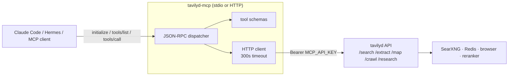
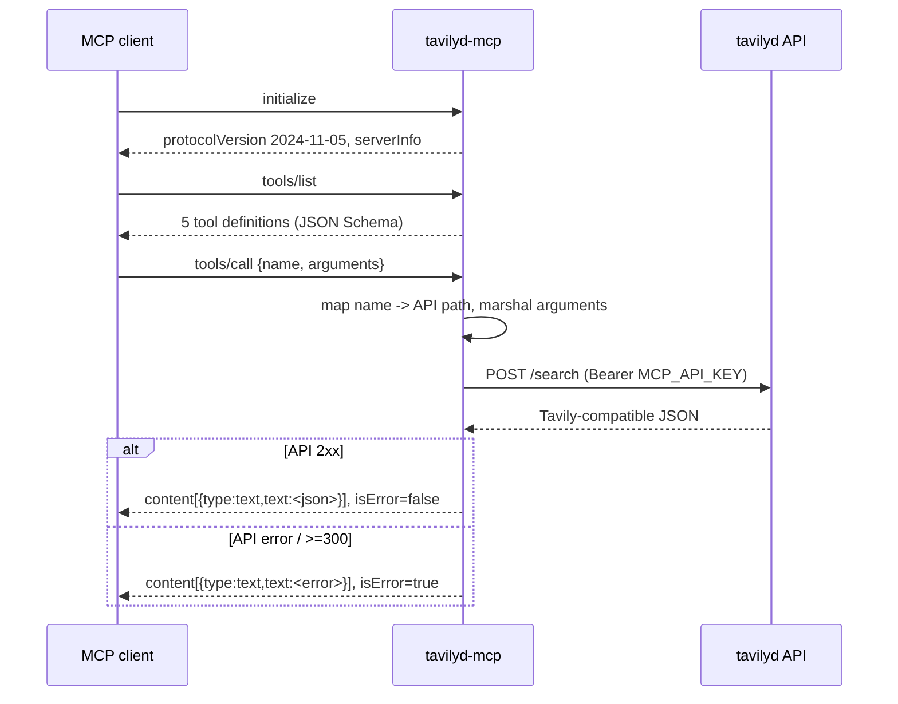

# MCP architecture

`cmd/mcp` is a protocol adapter, not a second search backend. It speaks the
Model Context Protocol (JSON-RPC 2.0) to a client such as Claude Code, Hermes or
a custom agent, and forwards tool calls to the tavilyd HTTP API with the
operator's key.

## Topology



## Modes

| mode | transport | use |
|---|---|---|
| stdio (default) | stdin/stdout JSON-RPC | Claude Code, Hermes, local agents |
| HTTP | `POST /mcp`, `GET /health` | remote agents on a private/Tailscale network |

The HTTP mode has **no authentication of its own**. Put it on loopback/Tailscale
or behind an authenticated reverse proxy. The MCP process itself uses
`MCP_API_KEY` when calling the API, so exposing it publicly lets anyone spend
that key.

## Request lifecycle



`initialize`, `ping` and `tools/list` are answered locally; only `tools/call`
touches the network. Notifications (`notifications/*`) are accepted without a
reply.

## Tools

| MCP tool | API endpoint | required |
|---|---|---|
| `tavily-search` | `POST /search` | `query` |
| `tavily-extract` | `POST /extract` | `urls` |
| `tavily-map` | `POST /map` | `url` |
| `tavily-crawl` | `POST /crawl` | `url` |
| `tavily-research` | `POST /research` | `input` |

Tool schemas are deliberately a subset of the full API so a model cannot pass
unknown/huge payloads. The MCP layer does not re-implement auth, quotas, caching
or SSRF protection; those stay in the API.

## Configuration

| env | default | effect |
|---|---|---|
| `MCP_API_URL` | `http://127.0.0.1:8080` | API base URL |
| `MCP_API_KEY` | empty | sent as `Authorization: Bearer` |

```bash
go build -o bin/mcp ./cmd/mcp
MCP_API_URL=https://your-api.example MCP_API_KEY=*** ./bin/mcp
```

## Limits and failure modes

- The MCP server has a **300 s** HTTP timeout; a slow research job returns its
  `request_id` immediately and is polled via `GET /research/{id}`.
- No MCP streaming yet; use the REST/SSE research endpoint for progress.
- MCP framing can succeed while the API returns zero results (upstream engines
  blocked). Check `GET /health` and `/usage`, not just `tools/list`.
- API `401` → bad/missing `MCP_API_KEY`; `429` → per-key rate limit; `432` →
  credit quota.
- A tool error is returned **inside** `result` with `isError: true` (MCP
  convention), not as a JSON-RPC protocol error.

## Source map

| file | role |
|---|---|
| `cmd/mcp/main.go` | stdin loop, HTTP handler, dispatcher, tool schemas, API forwarding |
| `docs/mcp.md` | operator/client guide + working demo |
| `internal/api/router.go` | HTTP endpoints the MCP server calls |
