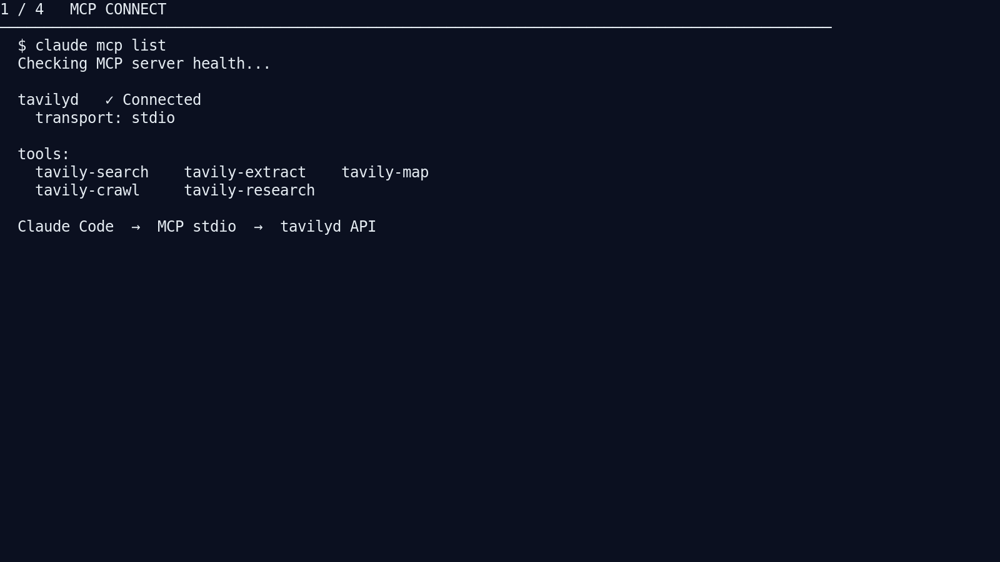

# MCP server

`cmd/mcp` exposes tavilyd as a [Model Context Protocol](https://modelcontextprotocol.io)
server. It is a thin JSON-RPC proxy: every tool call is forwarded to the local
HTTP API, so authentication, per-key rate limits, caching, proxying and credits
apply unchanged.

## Why use it

- Any MCP client (Claude Code, Hermes, Cursor, custom agents) gets web search,
  extraction, mapping, crawling and research as tools without writing an API
  client.
- One key and one policy layer: the MCP server does not bypass auth, quotas or
  rate limits.
- Works over **stdio** for local agents and **streamable HTTP** for remote
  agents on a private network.
- The API stays the source of truth; MCP is an adapter, not a second backend.

## Tools

| tool | forwards to | required args |
|---|---|---|
| `tavily-search` | `POST /search` | `query` |
| `tavily-extract` | `POST /extract` | `urls` |
| `tavily-map` | `POST /map` | `url` |
| `tavily-crawl` | `POST /crawl` | `url` |
| `tavily-research` | `POST /research` | `input` |

Search accepts the usual `search_depth`, `max_results`, `topic`, `time_range`,
`include_domains`, `exclude_domains`, `include_answer`. Extract accepts
`query`, `chunks_per_source`, `extract_depth`, `format`, `include_images`,
`include_favicon`. Research returns the API's `request_id`; poll
`GET /research/{id}` for the result.

## Build and run

```bash
go build -o bin/mcp ./cmd/mcp

# stdio (default), for Claude Code / Hermes / local agents
MCP_API_URL=http://127.0.0.1:8080 \
MCP_API_KEY="$API_KEY" \
./bin/mcp

# streamable HTTP on a private interface
./bin/mcp -http 127.0.0.1:8090
# POST http://127.0.0.1:8090/mcp
# GET  http://127.0.0.1:8090/health
```

| env | default | meaning |
|---|---|---|
| `MCP_API_URL` | `http://127.0.0.1:8080` | tavilyd base URL |
| `MCP_API_KEY` | empty | sent as `Authorization: Bearer` to the API |

The MCP process itself does **not** authenticate callers. Keep HTTP mode on
loopback/Tailscale, or put an authenticated reverse proxy in front of it. Never
expose `-http 0.0.0.0:8090` to the public internet.

## Client setup

### Claude Code

```bash
claude mcp add tavilyd -- env \
  MCP_API_URL=http://127.0.0.1:8080 \
  MCP_API_KEY="$API_KEY" \
  /absolute/path/to/bin/mcp
```

### Hermes / generic stdio client

```json
{
  "mcpServers": {
    "tavilyd": {
      "command": "/absolute/path/to/bin/mcp",
      "env": {
        "MCP_API_URL": "http://127.0.0.1:8080",
        "MCP_API_KEY": "<API_KEY>"
      }
    }
  }
}
```

### Remote HTTP client

Register `http://<tailscale-host>:8090/mcp` as a streamable HTTP MCP endpoint.
Protect the port with Tailscale/ACL or a reverse proxy.

## Protocol example

```json
{"jsonrpc":"2.0","id":1,"method":"initialize","params":{}}
{"jsonrpc":"2.0","id":2,"method":"tools/list"}
{"jsonrpc":"2.0","id":3,"method":"tools/call","params":{"name":"tavily-search","arguments":{"query":"kubernetes readiness probe","max_results":3}}}
```

`initialize` reports protocol `2024-11-05`; `tools/list` returns the five tools;
`tools/call` returns MCP content blocks containing the API's JSON response. If
the API returns an error/status >= 300, the tool result has `isError: true` and
the error text in the content block.

## Limits and troubleshooting

- The MCP server has a 300 s HTTP timeout; research jobs still return immediately
  with a `request_id`.
- No streaming over MCP yet; use the REST/SSE `/research/{id}` endpoint for
  progress.
- `401` from the API means `MCP_API_KEY` is missing/invalid. `429` means the key's
  token bucket is exhausted; `432` means the credit quota is exhausted.
- The HTTP MCP handler has no auth of its own; restrict it at the network layer.
- Verify the proxy separately with `initialize` + `tools/list` before debugging
  tool calls. A successful `tools/list` proves the MCP transport, not that the
  upstream API is healthy; check `GET /health` too.

## Verified status

Stdio `initialize`, `tools/list` (5 tools) and a `tools/call tavily-search`
round-trip were exercised against a running tavilyd instance. The MCP transport
returned valid JSON-RPC; an empty result set in that call came from upstream
search results, not from MCP framing. HTTP mode exposes `POST /mcp` and
`GET /health`; protect it as described above.

## Demo



Actual stdio run: Claude Code calls `tavily-search`, the MCP server forwards it
to the live API, and the response is a normal MCP content block. The capture
contains no API keys or internal endpoints. Static frame: `assets/mcp-demo-video.png`.
