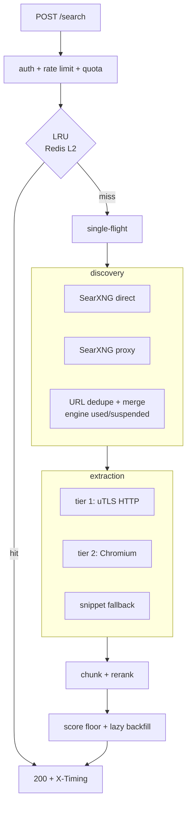

# Search architecture

The `/search` pipeline turns a query into ranked, extracted passages with a
single request-scoped deadline. This document focuses on discovery, extraction,
ranking and the failure paths that keep results flowing.

## Pipeline

## Discovery

- Two engines per query are selected round-robin from `SEARCH_ENGINES`.
- A blocked engine gets a client-side cooldown (`SEARCH_ENGINE_COOLDOWN`).
- For `basic`/`advanced`, the **direct and proxied SearXNG instances are queried
  in parallel** and results are unioned by canonical URL. One blocked instance
  therefore cannot reduce a query to a single engine.
- `fast`/`ultra-fast` use one instance to protect latency, falling back only
  when it returns nothing.
- Suspended engines are reported as `optional_degraded` but do not fail the
  request. `X-Timing` records the discovery stage.

## Extraction

| tier | mechanism | budget | when |
|---|---|---|---|
| 1 | uTLS HTTP, Chrome fingerprint, browser headers | `FETCH_BASIC_TIMEOUT` (2 s default) | every candidate |
| 2 | chromedp headless Chromium, images/fonts/media blocked | `FETCH_ADVANCED_TIMEOUT` (4 s) | `advanced` + short/challenge/non-HTML |

- Fetches are bounded by a weighted semaphore and an `errgroup`; the request
  context cancels stragglers.
- A failed or too-short page becomes its SearXNG snippet when
  `SNIPPET_FALLBACK=true`; it is never silently dropped.
- The initial fetch is `max_results + 2`; the extra pool is used lazily for
  backfill when the floor removes results.
- Every page is cached for 24 h (variant includes image mode), failures for
  5 min.

## Ranking

1. Markdown is split into ~350-token chunks with 50-token overlap, preferring
   heading/paragraph boundaries.
2. A lexical pre-filter keeps 1 chunk per page (`basic`) or 3 (`advanced`).
3. TEI-compatible `/rerank` scores the selected chunks; `fast` stays lexical.
4. Snippet-only documents are cross-encoded in one batch, overlapped with page
   fetching.
5. Per page, the best 1–3 chunks are assembled in document order; the page score
   is the best chunk score.
6. `MIN_RESULT_SCORE`, `MIN_RELATIVE_SCORE` and the snippet floor are applied.
   Fewer than `max_results` is valid; unused candidates are fetched for backfill
   only while the deadline allows.

## Budgets and failure modes

| control | behavior |
|---|---|
| hard deadline | `REQUEST_DEADLINE` (6 s); partial results where possible |
| discovery timeout | `SEARXNG_TIMEOUT`; returns 502/504 only if no candidates |
| tier-1 timeout | per-page; timeout becomes snippet fallback |
| tier-2 | only `advanced`; browser breaker/tab pool bound concurrency |
| reranker down | BM25 fallback, health degraded |
| Redis down | cacheless; no 5xx |
| all pages fail | snippet-only results; never an empty 200 |

`X-Timing: cache=…;search=…;tier1=…;tier2=…;rerank=…;total=…` carries the
per-stage timings. Quality/latency measurements and the funnel methodology live
in `BENCHMARKS.md`.

## Source map

| path | responsibility |
|---|---|
| `internal/search/` | SearXNG client, dedupe, domain filter, engine selection |
| `internal/extract/` | uTLS fetcher, browser pool, readability, cleanup, chunking |
| `internal/rerank/` | chunks, TEI client, BM25 fallback, preselect |
| `internal/api/handlers.go` | pipeline orchestration, cache, floors, backfill |
| `internal/cache/` | LRU + Redis + single-flight |
