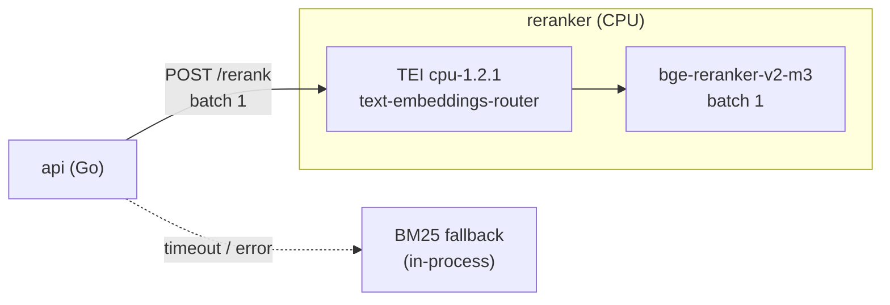

# CPU architecture (tavilyd-cpu)

The CPU path is the no-GPU deployment: the same Go API, SearXNG, Redis and
worker stack, with a CPU TEI reranker (or BM25-only fallback). It is intended for
small instances, CI, correctness testing and development — not for Tavily-level
latency.

## Topology



## Compose override

`docker-compose.cpu-reranker.yml` replaces the GPU service and sets client
limits:

```bash
docker compose -f docker-compose.yml -f docker-compose.cpu-reranker.yml up -d
```

| setting | value | reason |
|---|---|---|
| image | `ghcr.io/huggingface/text-embeddings-inference:cpu-1.2.1` | pinned CPU TEI |
| model | `BAAI/bge-reranker-v2-m3` | same model as GPU path |
| batch | `--max-batch-requests 1`, `--max-client-batch-size 1` | work around TEI CPU `non-contiguous lhs` batching bug |
| API batch | `TEI_MAX_BATCH=1` | must match server |
| API parallelism | `TEI_PARALLELISM=8` | use cores for independent requests |
| timeout | `TEI_TIMEOUT=2500ms` | leave room for fallback |
| GPU | `devices: !reset []` | no CUDA requirement |

## What changes for the API

Nothing in `/search`, `/extract`, auth, cache or MCP. The Go client still calls
`TEI_URL`, but the server is CPU. If a batch exceeds the CPU budget, the scorer
falls back to BM25 and logs the failure; `X-Timing` shows `rerank` lower and
`/health` may show `reranker` degraded.

Measured on a 20-core host: **0.6–1.0 s per 350-token chunk**, which is too slow
for five pages inside the 6 s request budget. Expect frequent BM25 fallback in
practice. This is why the GPU sidecar is the default production path.

## CPU-only / BM25-only

To run without any reranker, leave the `reranker` service unreachable (or point
`TEI_URL` at a closed port). The scorer's BM25 path keeps `/search` serving;
`/health` reports the reranker as down/degraded and metrics show rerank=0.
This is valid for a tiny single-user instance, not for quality-sensitive use.

## Sizing

| resource | guidance |
|---|---|
| CPU | 8+ cores for API + SearXNG + browser; 20 cores measured |
| RAM | 8–16 GB; browser `shm_size` is separate |
| disk | model cache ~2–3 GB, Redis AOF, page cache |
| no GPU | remove the `devices` reservation via the override |

## Failure and degradation

- CPU TEI health is checked by Compose; slow first model load can take minutes.
- Per-page rerank timeout → BM25 fallback; search never fails solely because the
  reranker is slow.
- If Redis is also absent, cacheless + BM25 still serves; only SearXNG is a hard
  discovery dependency.
- Keep `TEI_PARALLELISM` bounded; unbounded CPU rerank will starve page fetches.

## When to choose CPU

- Local development / CI with no NVIDIA GPU.
- Very low traffic where latency is secondary.
- A correctness baseline to compare against GPU/BM25.
- Not recommended for a paid API with the 1.8 s `basic` target.
