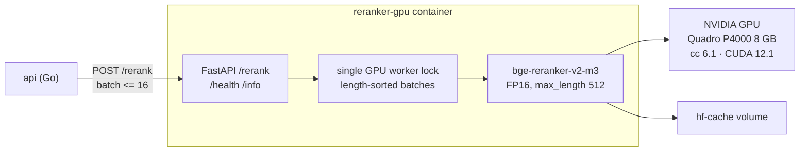

# GPU architecture (tavilyd-gpu)

The GPU path keeps the Go API unchanged and puts the cross-encoder in a separate
PyTorch sidecar that speaks the TEI `/rerank` contract. The API calls it over the
Compose network; if it is unavailable, the API falls back to BM25.

## Topology



## Components

| piece | detail |
|---|---|
| image | `reranker-gpu/Dockerfile` on `pytorch/pytorch:2.1.2-cuda12.1-cudnn8-runtime` |
| model | `BAAI/bge-reranker-v2-m3` (default; `RERANKER_MODEL` override) |
| precision | `RERANK_DTYPE=auto` → FP16 on CUDA; FP32/FP16 can be forced |
| batching | `RERANK_BATCH_SIZE=16`, `RERANK_MAX_LENGTH=512`, length-sorted |
| device | CDI request `nvidia.com/gpu=all`; nonroot uid 10001 |
| cache | named volume `hf-cache` mounted at `/data` |
| health | 200 only after model load + warmup inference |
| client | Go `internal/rerank/tei.go`, `TEI_URL=http://reranker:80` |

## Why a custom sidecar

The deployment GPU is a **Quadro P4000 (compute capability 6.1)**. TEI's CUDA
images require cc ≥ 7.0 and fail to start; TEI's CPU image is too slow for the
request budget and has a batching bug on this model. torch 2.1.2 + CUDA 12.1 is
the last wheel line shipping sm_61 kernels, so `app.py` pins that line and fails
loudly if `torch.cuda.get_arch_list()` lacks `sm_61`.

FP16 on Pascal is only ~5% faster than FP32 (no fast FP16 path), unlike
Ampere+. Measured 48 chunks × ~350 tokens: FP32 1391 ms, FP16 1319 ms.

## Scoring path

1. Go chunker produces ~350-token chunks.
2. Lexical preselect keeps 1 chunk/page (basic) or 3 (advanced).
3. Go sends `{query, texts, raw_scores:false}` to `/rerank`.
4. Sidecar sorts pairs by length, batches at 16, runs `inference_mode`, applies
   sigmoid unless `raw_scores=true`, returns `[{index, score}]`.
5. Go maps scores back to chunks, assembles content, applies floors.

Measured reranker cost on the P4000: **p50 338 ms** (basic) and **930 ms**
(advanced) in the earlier GPU benchmark; peak VRAM **3830 MiB**, steady ~2.8 GB.
Current end-to-end latency is dominated by discovery, not reranking.

## Failure and degradation

| event | behavior |
|---|---|
| sidecar down / timeout | Go logs, uses BM25, request still succeeds |
| GPU missing / wrong arch | container exits; `/health` reports reranker down |
| breaker open | fast-fail to BM25 until half-open probe |
| OOM / long batch | bounded `TEI_MAX_BATCH`, `TEI_PARALLELISM`, 1–2 s timeout |
| health probe | model load can take minutes on first start (HF download) |

The reranker is a **core** health dependency in `/health` (a down GPU makes the
overall status degraded/down), even though `/search` can still answer with BM25.
Operators should alert on `reranker` status and `X-Timing` rerank latency.

## Deploy

```bash
docker compose up -d --build reranker api
docker compose exec reranker python -c "import torch; print(torch.cuda.get_arch_list())"
curl -sS http://localhost:8080/health | jq '.dependencies.reranker'
```

For a host without the NVIDIA Container Toolkit/CDI, use
`docker-compose.cpu-reranker.yml` (see CPU architecture) or leave the reranker
down and accept BM25 fallback.
